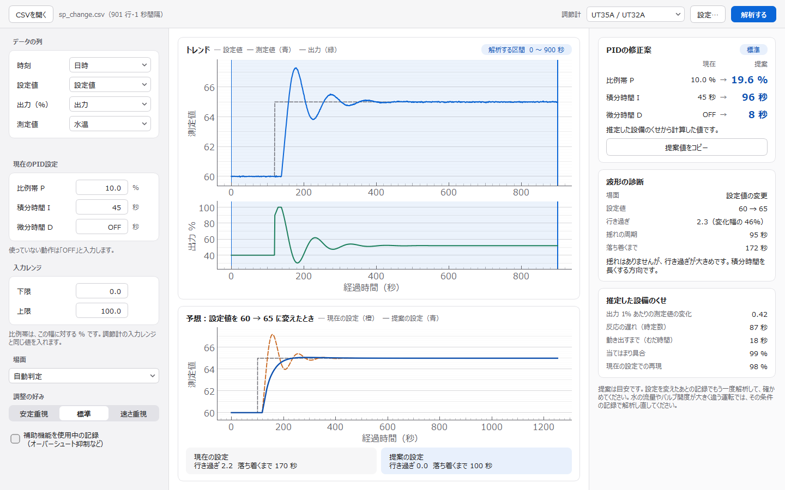

# PID調整アドバイザー

温度調節計の記録（設定値・出力%・測定値）と、今の P・I・D の設定から、
P・I・D をどう直せばよいかを示す Windows アプリです。

記録から設備のくせ（反応の遅れ・動き出すまでの時間など）を推定し、
修正案と「設定値を変えたときに温度がどう動くか」の予想グラフを示します。

初期設定は横河電機 UT35A / UT32A に合わせてあります。ほかの調節計で使うときは、
［設定…］から「複製して新規」で値を変えて保存します。



> **免責事項**
>
> - 本ソフトウェアは「現状のまま」提供され、いかなる保証もありません。
> - 本ソフトウェアの使用により生じたいかなる損害についても、作者は責任を負いません。
> - 修正案は推定にもとづく目安です。設備の運転・安全の判断や、法令にもとづく記録には、本ソフトウェアだけを使わないでください。
> - 本ソフトウェアは横河電機株式会社とは関係のない、個人による非公式のツールです。
> - 見本データ（`samples` フォルダ）と説明書の画面写真の数値は、計算で作った架空のものです。

詳しい使い方は [取扱説明書](docs/manual/取扱説明書.md)（[PDF](docs/manual/取扱説明書.pdf)）を見てください。

## 動作環境

- Windows 10 / 11（64bit）
- Python 3.14（[python.org](https://www.python.org/downloads/windows/) からインストール）
- インターネット接続は、セットアップのときだけ必要です

## 入手と起動

1. このページの右側の「Releases」から、`pid-tuning-advisor-v0.1.0.zip` をダウンロードします。
   緑色の「Code」ボタンの「Download ZIP」と、「Source code (zip)」は開発用です。選ばないでください。
2. zip を右クリック →「プロパティ」で、下のほうの「許可する」にチェックを入れて「OK」を押します。
3. zip を右クリック →「すべて展開」で展開します。
4. 展開したフォルダの `セットアップ.bat` をダブルクリックします（1 回だけ）。
   部品のダウンロードが終わると、フォルダの中に「PID調整アドバイザー」のショートカットができます。
5. ショートカット（または `起動.bat`）で起動します。

## 使い方（あらまし）

1. ［CSVを開く］で記録ファイルを選びます（`samples` フォルダに見本があります）。
2. 「データの列」で、時刻・設定値・出力・測定値の列を選びます。
3. 「現在のPID設定」と「入力レンジ」を入力します。使っていない動作は `OFF` と入力します。
4. グラフの青い帯の両端をドラッグして、解析する区間を選びます。
5. ［解析する］を押すと、右側に修正案、中央下に予想グラフが出ます。

## 見本データ

`samples` フォルダの CSV は、計算で作った架空の設備のデータです。入力レンジは 0〜100 です。

| ファイル | 場面 | 入力する現在の設定 |
|---|---|---|
| `sp_change.csv` | 設定値を 60→65℃ に変更 | P 10.0 / I 45 / D OFF |
| `hunting.csv` | 設定値一定で温度が揺れ続ける | P 2.5 / I 20 / D OFF |
| `manual_step.csv` | 手動で出力を 40→50% に変更 | （何でもよい。例：P 10.0 / I 45 / D OFF） |

## 開発者向け

```
py -3.14 -m venv .venv
.venv\Scripts\python.exe -m pip install -r requirements.txt -r requirements-dev.txt
.venv\Scripts\python.exe -m pytest tests -q
```

- 設計書は `docs/superpowers/specs/`、実装計画は `docs/superpowers/plans/` にあります（Claude Code で開発した記録です）。
- 取扱説明書の写真は `docs/manual/shoot.py`、PDF は `docs/manual/make_pdf.py` で作り直せます。

## ライセンス

本ソフトウェアは [GNU General Public License v3.0](LICENSE) のもとで公開しています。

Copyright (C) 2026 Nagasaki-Software

利用している外部ライブラリのライセンスは [THIRD_PARTY_NOTICES.md](THIRD_PARTY_NOTICES.md) を参照してください。画面に GPL-3.0 の PyQt6 を使っているため、本ソフトウェアも GPL-3.0 としています。
