# PID調整アドバイザー 取扱説明書

版：v0.1.1

温度調節計の記録（設定値・出力%・測定値）と、今の P・I・D の設定から、**P・I・D をどう直せばよいか**を示すアプリです。記録から設備のくせ（反応の遅れ・動き出すまでの時間など）を推定し、修正案と「設定値を変えたときに温度がどう動くか」の予想グラフを示します。

出力で温度を調節する設備なら、種類を問わず使えます。たとえば次のような設備です。

- 蒸気のバルブ開度で、水や油の温度を調節する
- 電気ヒーターの出力で、タンクや槽の温度を調節する
- ヒーターで空気を温める（熱風発生機・乾燥炉など）
- 冷却水のバルブで冷やす（正動作）

調節計の初期設定（同梱の「標準」）は、一般的なディジタル指示調節計（例：横河電機 UT35A）の値です。ほかの調節計でも、設定画面で値を変えれば使えます。

> **免責事項**
>
> - 本ソフトウェアは「現状のまま」提供され、いかなる保証もありません。
> - 本ソフトウェアの使用により生じたいかなる損害についても、作者は責任を負いません。
> - 修正案は推定にもとづく目安です。設備の運転・安全の判断や、法令にもとづく記録には、本ソフトウェアだけを使わないでください。
> - 本ソフトウェアは横河電機株式会社とは関係のない、個人による非公式のツールです。
> - この説明書の画面写真と見本データの数値は、計算で作った架空の設備のものです。

### 目次

1. [画面の見かた](#1-画面の見かた)
2. [入手と起動](#2-入手と起動)
3. [記録（CSV）の用意](#3-記録csvの用意)
4. [解析のしかた](#4-解析のしかた)
5. [結果の見かた](#5-結果の見かた)
6. [修正案を試すときの注意](#6-修正案を試すときの注意)
7. [調節計の設定（ほかの調節計で使う）](#7-調節計の設定ほかの調節計で使う)
8. [設定とログの保存場所](#8-設定とログの保存場所)
9. [困ったとき](#9-困ったとき)
10. [ライセンス](#10-ライセンス)

## 1. 画面の見かた

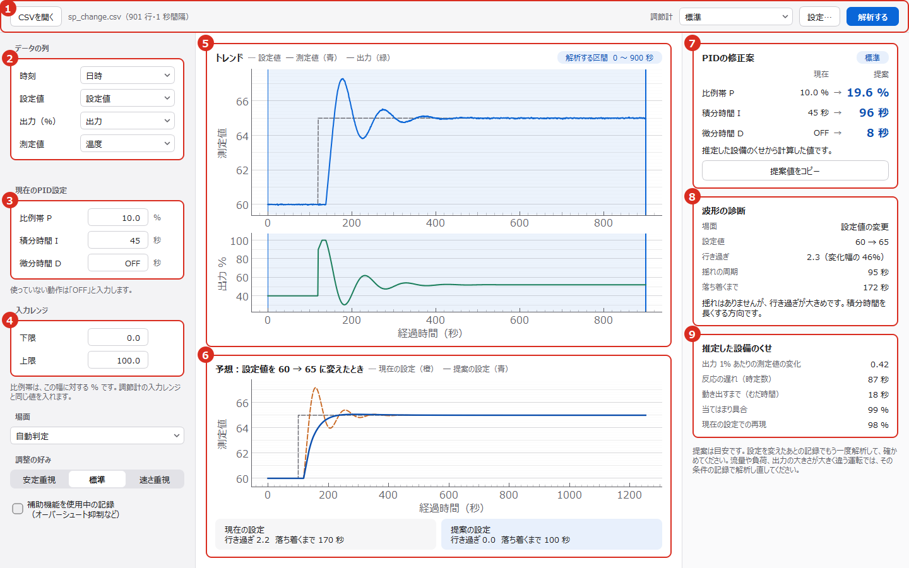

*見本の記録（設定値を 60 から 65 に変えたとき）を解析した画面*

| 番号 | 名前 | 役目 |
|---|---|---|
| 1 | ツールバー | ［CSVを開く］、調節計の選択、［設定…］、［解析する］ |
| 2 | データの列 | CSV のどの列が時刻・設定値・出力・測定値かを選びます |
| 3 | 現在のPID設定 | 調節計に今入っている P・I・D を入れます |
| 4 | 入力レンジ | 調節計の入力レンジ（下限・上限）を入れます |
| 5 | トレンド | 記録のグラフ。上が設定値（破線）と測定値（青）、下が出力（緑）。青い帯が解析する区間です |
| 6 | 予想グラフ | 設定値を変えたとき、今の設定（橙の破線）と修正案（青）で温度がどう動くかの予想 |
| 7 | PIDの修正案 | P・I・D の「現在 → 提案」と、その理由 |
| 8 | 波形の診断 | 行き過ぎ・揺れの周期・落ち着くまでの時間など、記録の様子 |
| 9 | 推定した設備のくせ | 記録から推定した設備の特性と、推定の当てはまり具合 |

### 動作環境

- Windows 10 / 11（64bit）
- Python 3.14
- インターネット接続は、セットアップのときだけ必要です

## 2. 入手と起動

### 2-1. ダウンロードと展開

1. GitHub のリポジトリのページで「Releases」を開き、`pid-tuning-advisor-v0.1.1.zip` をダウンロードします。
   - 緑色の「Code」ボタンの「Download ZIP」と、「Source code (zip)」は開発用です。選ばないでください。
2. ダウンロードした zip を右クリック →「プロパティ」を開きます。下のほうの「許可する」にチェックを入れて「OK」を押します。
3. zip を右クリック →「すべて展開」で、使いやすい場所に展開します。

### 2-2. Python のインストール（初めてのときだけ）

[python.org](https://www.python.org/downloads/windows/) から **Python 3.14** の Windows 用インストーラーをダウンロードして、インストールします。

### 2-3. セットアップ（初めてのときだけ）

展開したフォルダの `セットアップ.bat` をダブルクリックします。

- インターネットから画面とグラフの部品をダウンロードします。数分かかります。
- 終わると、フォルダの中に **「PID調整アドバイザー」のショートカット**（アイコン付き）ができます。デスクトップなどに移して使えます。

### 2-4. 起動

ショートカット、または `起動.bat` をダブルクリックします。

## 3. 記録（CSV）の用意

### 3-1. 使える記録

次の 4 つの列が入った CSV ファイルを使います。

| 列 | 中身 |
|---|---|
| 時刻 | 日時（`2026/11/14 10:00:00` など）、時刻（`10:00:00`）、または秒の数値。無くてもかまいません（記録の間隔を入力します） |
| 設定値 | 調節計の設定値（SP） |
| 出力 | 調節計の出力（バルブ開度、ヒーター出力など）。0〜100 % |
| 測定値 | 制御している温度（PV） |

- 記録計や Excel で保存した CSV を、そのまま読み込めます。説明の行や単位の行が先頭にあっても、数値の行を自動で探します。
- 文字コードは UTF-8 と Shift-JIS（Excel の既定）のどちらでも読めます。区切りはカンマ・タブ・セミコロンに対応します。
- 列の名前は自由です。読み込んだあと画面で選び直せます。

### 3-2. 解析に向く記録のとり方

いちばん精度が出るのは、**設定値を少し変えたときの記録**です。

1. 温度が落ち着いている状態から、設定値を 2〜5 ℃ だけ変えます。
2. 温度が新しい設定値で落ち着くまで（目安 10〜20 分）記録します。
3. その間、流量や負荷（温める物の量・風量など）、ほかの条件はなるべく変えないでください。

次の記録も使えます。

- **温度が揺れ続けている（ハンチングしている）記録**：設定値は一定のまま、揺れている間を記録します。
- **調節計を手動にして、出力を一段変えた記録**：出力を変えたあと、温度が落ち着くまで記録します。

## 4. 解析のしかた

### 4-1. CSV を開いて列を選ぶ

［CSVを開く］で記録ファイルを選びます。ツールバーにファイル名・行数・記録の間隔が出て、グラフが描かれます。

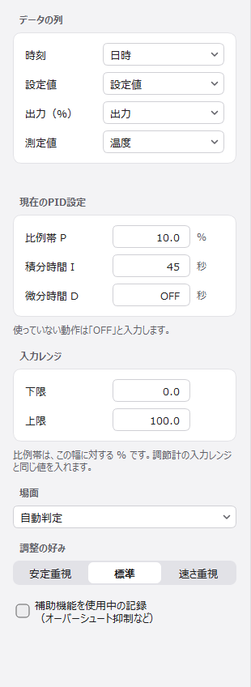

*左側の入力欄*

「データの列」で、時刻・設定値・出力（%）・測定値の列を選びます。列の名前から自動で選ばれますが、違っていたら選び直してください。時刻の列が無いときは、時刻で「（なし）」を選ぶと「記録の間隔」の欄が出るので、記録の間隔（秒）を入れます。

### 4-2. 現在の設定と入力レンジを入れる

- **現在のPID設定**：調節計に今入っている P（比例帯 %）・I（積分時間 秒）・D（微分時間 秒）を入れます。使っていない動作は `OFF` と入れます。空欄のままでは解析できません。
- **入力レンジ**：調節計の入力レンジ（例：0.0〜100.0 ℃）を入れます。比例帯はこの幅に対する % なので、**調節計と同じ値**を入れてください。違うと、比例帯の修正案がずれます。

入力した値は、次に起動したときも残っています。

### 4-3. 解析する区間を選ぶ

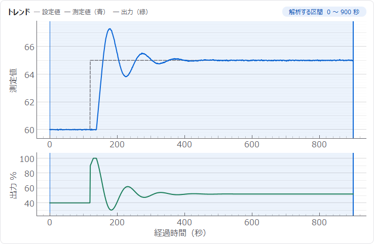

*青い帯が解析する区間です*

グラフの青い帯の左右の端をドラッグして、解析する区間を選びます。初めは記録の全体です。

- 設定値を変えた記録なら、**変える少し前から、落ち着くまで**を選びます。
- 記録が長い（何時間・何日分）ときは、必要な部分だけを選ぶと精度が上がります。長いまま解析すると、注意書きが出ます。

### 4-4. 場面・調整の好みを選んで解析する

- **場面**：ふつうは「自動判定」のままにします。判定が違うときだけ、「設定値の変更」「温度の揺れ（ハンチング）」「手動で出力を変更」から選びます。
- **調整の好み**：「安定重視」は行き過ぎが出にくくゆっくり、「速さ重視」は速く落ち着くが少し攻めた設定になります。迷ったら「標準」にします。
- **補助機能を使用中の記録**：調節計のオーバーシュート抑制機能などを使っていた記録なら、チェックを入れます。推定がずれる可能性があるという注意書きが出ます。

［解析する］を押すと、右側と中央下に結果が出ます。

## 5. 結果の見かた

### 5-1. PIDの修正案

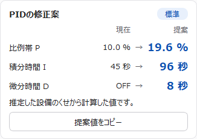

P・I・D の「現在 → 提案」が出ます。提案は、調節計に入力できる刻み（「標準」なら比例帯 0.1 %、積分・微分 1 秒）に丸めてあります。

- 計算の事情で値を変えたとき（調節計の設定範囲に収めた、微分を OFF にした、など）は、その理由が下に出ます。
- ［提案値をコピー］を押すと、「比例帯 P = 19.6 % / 積分時間 I = 96 秒 / 微分時間 D = 8 秒」のような文が、メモ帳などに貼り付けられます。

### 5-2. 波形の診断

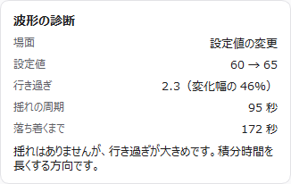

記録の様子と、**調整の方向**（例：「積分時間を長くする方向です」）が出ます。出る項目は場面によって変わります。

| 場面 | 出る項目 |
|---|---|
| 設定値の変更 | 設定値の変化、行き過ぎ（測定値の単位と、変化の幅に対する %）、揺れの周期、落ち着くまでの時間 |
| 温度の揺れ | 揺れの幅（測定値・出力）、揺れの周期、揺れの傾向（収まっていく／続いている／広がっている）、出力が上限・下限に張り付いている割合 |
| 手動で出力を変更 | 出力の変化、測定値の変化、変化の 63 % に達するまでの時間 |

「落ち着くまで」は、測定値が変化の幅の ±5 % に入り、そのあと出なくなるまでの時間です。

### 5-3. 推定した設備のくせ

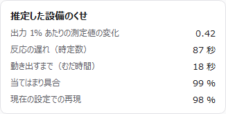

| 項目 | 意味 |
|---|---|
| 出力 1% あたりの測定値の変化 | 出力を 1 % 上げると（バルブを 1 % 開ける、ヒーターを 1 % 強めるなど）、落ち着いたあと温度がどれだけ変わるか |
| 反応の遅れ（時定数） | 温度が変化し始めてから、変化の 63 % に達するまでの時間 |
| 動き出すまで（むだ時間） | 出力を変えてから、温度が動き始めるまでの時間 |
| 当てはまり具合 | 推定した特性で計算した温度が、記録とどれだけ合うか。**90 % 以上なら信用できます** |
| 現在の設定での再現 | 今の P・I・D と推定した特性で計算した温度が、記録とどれだけ合うか（設定値の変更の記録のときだけ）。低いときは、入力した P・I・D や入力レンジが実機と違う可能性があります |

温度が揺れ続けているだけの記録では、反応の遅れ（時定数）を一つに絞れないことがあります。そのときは「一つに絞れません」と出て、変化の速さとむだ時間から、**安全側（積分を弱め）**の修正案を出します。

### 5-4. 予想グラフ

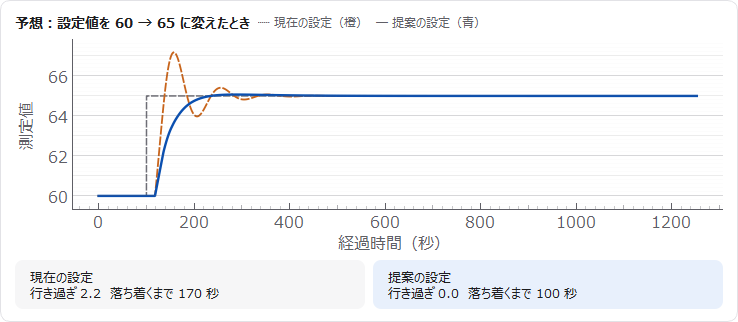

設定値を変えたとき、今の設定（橙の破線）と修正案（青）で、温度がどう動くかの予想です。下に、それぞれの行き過ぎと落ち着くまでの時間が出ます。設定値の変更以外の記録では、記録の平均から入力レンジの 5 % だけ設定値を上げた場合を予想します。

予想は、推定した設備の特性と、調節計の計算のしかた（設定画面の値）をもとに計算したものです。実機とは違うことがあります。

### 5-5. 温度が揺れている記録の例

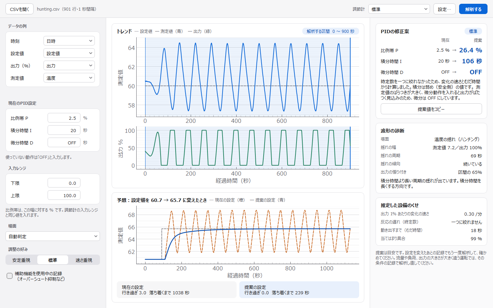

*見本の、温度が揺れ続けている記録（P 2.5 % / I 20 秒）を解析した画面。比例帯を大きく広げ、積分時間を長くする修正案が出ています*

### 5-6. 修正案が出ないとき

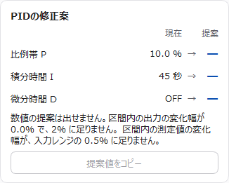

記録から設備のくせを推定できないときは、数値の修正案を出さず、その理由を表示します。主な理由と対処は次のとおりです。

| 表示 | 対処 |
|---|---|
| 区間内の出力の変化幅が 2% に足りません | 出力が動いている区間を選びます |
| 区間内の測定値の変化幅が、入力レンジの 0.5% に足りません | 温度が動いている区間を選びます |
| 当てはまり具合が 70% に足りません | 外乱（流量の変化など）が少ない区間を選びます |
| 出力を上げたときの測定値の動きが、動作の向きの設定と合いません | 設定画面の「動作の向き」（加熱は逆動作、冷却は正動作）を確かめます |
| 反応の遅れが区間の長さに対して長すぎて… | もっと長い区間を選びます |
| 反応が記録の間隔に比べて速すぎて… | もっと短い間隔で記録します |

## 6. 修正案を試すときの注意

- **修正案は目安です。** いきなり修正案の値にせず、今の値と修正案の**中間**から試すと安全です。
- 設定を変えたら、もう一度設定値を変えて記録し、解析し直して、予想どおりに良くなったかを確かめてください。
- 流量や負荷、出力の大きさが大きく違う運転では、設備のくせが変わります。その条件の記録で解析し直してください。
- 調節計の設定を変えるときは、設備の安全を確かめてから行ってください。

## 7. 調節計の設定（ほかの調節計で使う）

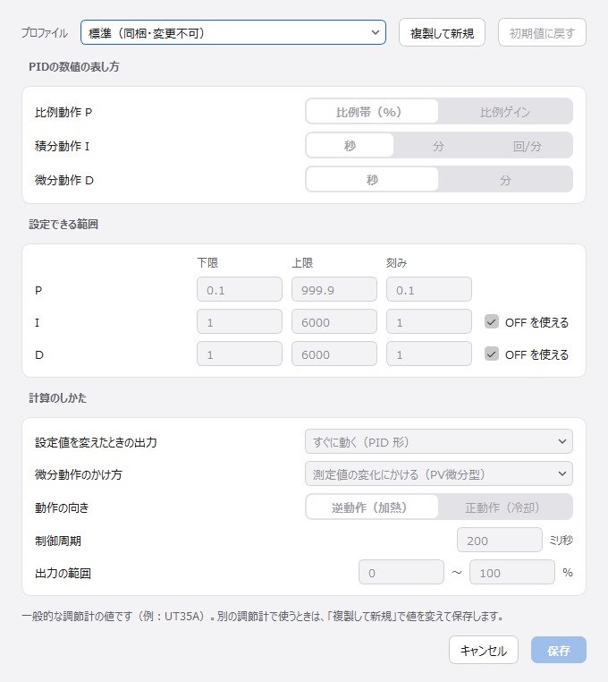

［設定…］を押すと、調節計ごとに変わる値（プロファイル）の画面が開きます。

- 同梱の「標準」は、一般的なディジタル指示調節計の値で、変更できません。
- ほかの調節計で使うときは、［複製して新規］で名前を付けて写し、お使いの調節計の取扱説明書を見ながら値を変えて［保存］を押します。メイン画面の「調節計」で選べるようになります。
- ［初期値に戻す］は、選んでいるプロファイルの値を「標準」の値に戻します（名前はそのまま）。

| 項目 | 内容 |
|---|---|
| PIDの数値の表し方 | P を比例帯（%）か比例ゲインか、I・D を秒か分か（I は回/分も）で表すか |
| 設定できる範囲 | P・I・D の下限・上限・刻みと、OFF にできるか。修正案はこの範囲と刻みに合わせます |
| 設定値を変えたときの出力 | 「すぐに動く（PID 形）」か、「急には動かない（I-PD 形）」。比例動作を偏差にかけるか、測定値にかけるかの違いです |
| 微分動作のかけ方 | 測定値の変化にかける（PV微分型）か、偏差の変化にかける（偏差微分型） |
| 動作の向き | 逆動作（加熱：温度が下がると出力を上げる）か、正動作（冷却） |
| 制御周期・出力の範囲 | 予想グラフの計算に使います |

## 8. 設定とログの保存場所

すべて `%APPDATA%\pid-tuning-advisor` の中に保存します（エクスプローラーのアドレス欄に `%APPDATA%\pid-tuning-advisor` と入れると開けます）。

| ファイル | 中身 |
|---|---|
| `settings.json` | 最後に使った調節計と、入力した P・I・D・入力レンジ・調整の好み |
| `profiles\<名前>.json` | ［複製して新規］で作った調節計のプロファイル |
| `error.log` | 想定していないエラーが起きたときの記録 |

初めて起動したときは、これらのファイルはありません。使ううちに作られます。

## 9. 困ったとき

| 症状 | 対処 |
|---|---|
| 「CSV を読めませんでした」と出る | ファイルを Excel などで開いていたら閉じてから選び直します。数値の列が無い場合も出ます |
| 欄が赤くなり、解析できない | 赤い欄に数値（使っていない動作は `OFF`）を入れます。P・I・D は調節計の設定範囲の中の値にします |
| 修正案が出ない | [5-6](#5-6-修正案が出ないとき) を見てください |
| 「現在の設定で計算した波形が、記録と合いません」と出る | 入力した P・I・D・入力レンジが実機と同じか、設定画面の「計算のしかた」が実機と同じかを確かめます |
| 起動しない | `セットアップ.bat` をもう一度実行します。Python 3.14 が入っているかも確かめます |
| エラーの窓が出た | 内容が `%APPDATA%\pid-tuning-advisor\error.log` に記録されています |

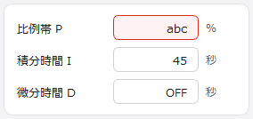

*数値でない文字を入れて解析したときの表示*

## 10. ライセンス

本ソフトウェアは GNU General Public License v3.0 のもとで公開しています。

Copyright (C) 2026 Nagasaki-Software

利用している外部ライブラリのライセンスは、リポジトリの `THIRD_PARTY_NOTICES.md` を見てください。「UT35A」は横河電機株式会社の製品名です。対応する調節計の例として名前を挙げています。
